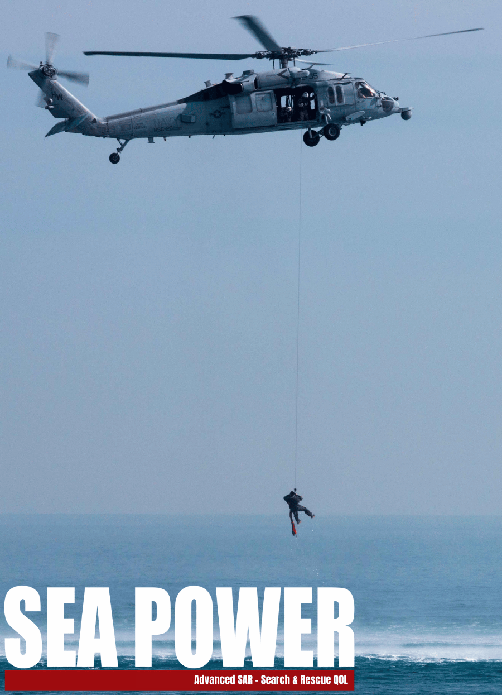

# Advanced SAR - Search & Rescue Quality of Life

## Features

- Toggle color-coded markers on the tactical map for life boats/rafts, see how many survivors are aboard each one.
- Use **Begin SAR** for friendly survivors or **Begin SAR for Enemy Survivors** for enemy survivors from a helicopter's **Orders > Search & Rescue** menu. **Cancel SAR** stops either order.
- Helicopters spread out across rafts for their selected side, prioritize rafts based on distance and survivor count, and check they have enough fuel to make the trip.
- When a raft has more survivors than one helicopter can seat, more helicopters join until there are enough free seats for everyone. The first to arrive picks up while the others hold nearby, then they take turns. Helicopters that are no longer needed move on to another raft.
- From a ship's **Orders > Search & Rescue** menu, choose friendly or enemy survivors to dispatch its airborne helicopters with free seats and prepare its embarked helicopters. The flight deck selects the rescue, transport, passenger, ferry, or empty loadout with the most seats. You can cancel a queued launch from the flight deck.
- Helicopters descend, hover for pickup, and move on to another raft if they have room and fuel.
- Helicopters return to where they launched from (ship, airfield, etc), unload survivors, and relaunch automatically if reachable rafts remain. 
- When another raft is reachable on the fuel aboard and the deck is clear for departure, a healthy helicopter unloads at touchdown, keeps its rotors spinning, and takes off from the same spot. Helicopters that need servicing use the normal recovery sequence.

## Roadmap

- Ship SAR launches only as many helicopters as the survivors need, and checks distance and fuel before launching.
- Tweaks and improvements for preformance and stability
- Improving pathing and logic
- More realistic searching 

## Credits

Sea Power mod loader by Kanalratte and AGM-114. [R.A.T.S. Keel on Steam Workshop](https://steamcommunity.com/sharedfiles/filedetails/?id=3835527459)

Uicons by [Flaticon](https://www.flaticon.com/uicons).

Logo background courtesy of [U.S. Army](https://www.army.mil/article/162132/sarex_in_the_arabian_gulf).

U.S. Navy SH-60B Seahawk photo via [NARA on GetArchive](https://nara.getarchive.net/media/aerial-stern-view-of-a-us-navy-usn-sh-60b-seahawk-helicopter-antisubmarine-38f96b).
